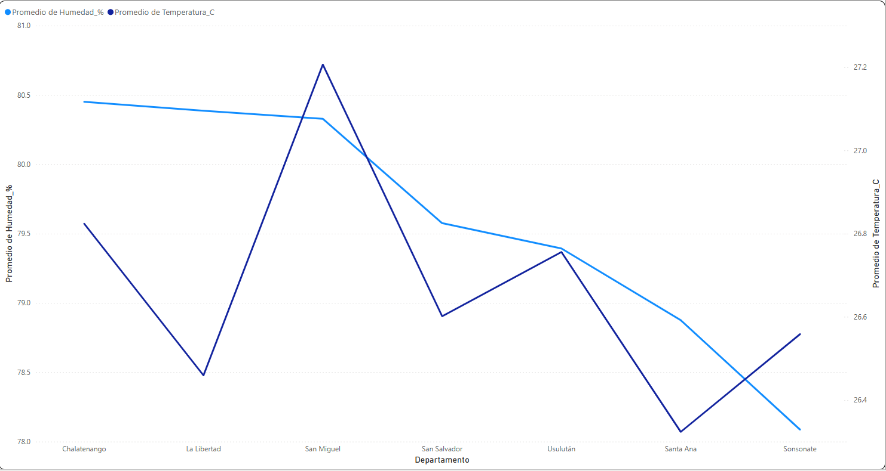

# 🌦️ Dashboard de análisis climático — El Salvador


Un tablero de Power BI que convierte un año de lecturas meteorológicas agrícolas
de **7 departamentos de El Salvador** en una vista interactiva de temperatura,
humedad, lluvia y condiciones de siembra.

El objetivo no era solo graficar números: los datos están modelados para una
decisión — *¿hoy es un buen día para sembrar maíz y frijol?* — y el tablero está
construido alrededor de esa pregunta.

<p align="center">
  
</p>

---

## Tabla de contenidos

- [Hallazgos principales](#hallazgos-principales)
- [El tablero](#el-tablero)
- [El dataset](#el-dataset)
- [Modelo de datos y medidas](#modelo-de-datos-y-medidas)
- [Estructura del proyecto](#estructura-del-proyecto)
- [Reproducir el análisis](#reproducir-el-análisis)
- [Decisiones de diseño y limitaciones](#decisiones-de-diseño-y-limitaciones)
- [Próximos pasos](#próximos-pasos)

---

## Hallazgos principales

| # | Hallazgo | Evidencia |
| - | -------- | --------- |
| 1 | **La lluvia es fuertemente estacional.** El 78 % de la lluvia del año cae entre mayo y octubre. | 4 024,7 mm de un total de 5 136,7 mm |
| 2 | **La temperatura es muy estable.** Las medias mensuales se mueven en apenas 1,2 °C en todo el año. | 25,9 °C (ene) – 27,1 °C (oct) |
| 3 | **La humedad es la variable más volátil.** Recorre todo el rango de 50 a 100 %, mientras la temperatura se mueve en una banda mucho más angosta. | σ humedad = 10,0 vs σ temperatura = 4,0 |
| 4 | **San Miguel es el departamento más cálido** y Santa Ana el más fresco. | 27,2 °C vs 26,3 °C de media |
| 5 | **El total de lluvia por departamento engaña.** San Salvador tiene 3 veces más lecturas que Sonsonate. | 457 vs 139 registros |

El `62,5 %` de las lecturas están etiquetadas como *"Buena para Maíz/Frijol"*, el
`37,1 %` como *"No óptima – baja humedad o extremo temperatura"* y el `0,4 %`
(6 lecturas) como *"Alta lluvia – riesgo de erosión/inundación"*.

Extremos encontrados en el dataset:

| Récord | Valor | Fecha | Departamento |
| ------ | ----- | ----- | ------------ |
| Lectura más cálida | 36,0 °C | 2025-02-06 00:00 | Usulután |
| Lectura más fría | 18,0 °C | 2025-01-11 12:00 | Santa Ana |
| Lectura más lluviosa | 48,6 mm | 2025-09-29 18:00 | Usulután |

---

## El tablero

| Visual | Pregunta que responde |
| ------ | --------------------- |
| **Tabla de registros** (arriba a la izquierda) | ¿Cómo se ve cada lectura? Incluye humedad y temperatura formateadas. |
| **Lluvia por departamento** (torta) | ¿Qué departamento recibe más lluvia en promedio? |
| **Humedad máxima por departamento/mes** (columnas) | ¿Dónde y cuándo llega al pico la humedad? |
| **Tarjetas de KPI** | ¿Cuál fue la temperatura (36,0 °C) y la humedad (100 %) máximas registradas? |
| **Humedad vs temperatura** (líneas de doble eje) | ¿Los departamentos más cálidos tienden a ser más secos? |
| **Segmentadores** (rango de fechas + departamento) | Filtran todos los visuales por período o por región |

<p align="center">
  
</p>

---

## El dataset

`data/dataset.csv` — 1 460 registros, sin valores faltantes.

| Columna | Tipo | Descripción |
| ------- | ---- | ----------- |
| `Fecha` | fecha | Fecha de la lectura (`2025-01-01` → `2025-12-31`) |
| `Hora` | int | Hora de la lectura: `0`, `6`, `12`, `18` |
| `Departamento` | texto | Uno de los 7 departamentos |
| `Temperatura_C` | float | Temperatura del aire en °C (18,0 – 36,0) |
| `Humedad_%` | float | Humedad relativa, 0–100 (50 – 100) |
| `Lluvia_mm` | float | Lluvia en mm (0,0 – 48,6) |
| `Recomendacion_Siembra` | categoría | Recomendación de siembra por reglas (3 clases) |

**Estructura:** 365 días × 4 lecturas por día = 1 460 registros. Cada lectura se
asigna a un departamento, así que el muestreo es *desigual* (San Salvador 457,
La Libertad 233, Santa Ana 209 y alrededor de 140 los demás) — por eso el tablero
compara **promedios** y no totales.

> ⚠️ Los datos son **simulados** (la tabla de origen se llama
> `datos_meteorologicos_agricolas_sv_simulados`), así que demuestran el flujo de
> análisis, no mediciones climáticas reales. Una pista: la lectura más caliente
> del dataset está registrada a las **00:00**.

<p align="center">
  
</p>

---

## Modelo de datos y medidas

El tablero usa una única tabla plana importada del CSV, más medidas DAX para los
KPI y los ejes formateados.

```DAX
Humedad Formateada =
AVERAGE('datos_meteorologicos_agricolas_sv_simulados'[Humedad_%]) / 100

Maximo de Humedad =
MAX('datos_meteorologicos_agricolas_sv_simulados'[Humedad_%]) / 100

maximo de temperatura =
MAX('datos_meteorologicos_agricolas_sv_simulados'[Temperatura_C])

temp format =
AVERAGE('datos_meteorologicos_agricolas_sv_simulados'[Temperatura_C]) / 100
```

La división por 100 es un **truco de formato**: lleva valores de 0–100 a 0–1 para
que el formato de porcentaje de Power BI los muestre bien. Ver
[limitaciones](#decisiones-de-diseño-y-limitaciones) para entender por qué no es
lo ideal.

---

## Estructura del proyecto

```text
climate-data-analysis-dashboard/
├── data/
│   └── dataset.csv                 # 1 460 registros, 2025
├── powerbi/
│   └── climate-dashboard.pbix      # tablero (Power BI Desktop)
├── scripts/
│   ├── summarize.py                # reproduce los números de arriba con pandas
│   └── requirements.txt
├── docs/images/                    # capturas usadas en este README
│   ├── dashboard.png
│   ├── chart.png
│   └── dataset.png
└── README.md
```

---

## Reproducir el análisis

### Abrir el tablero

1. Instalá [Power BI Desktop](https://powerbi.microsoft.com/desktop/) (gratis, Windows).
2. Abrí `powerbi/climate-dashboard.pbix`.
3. Si Power BI pide el origen de datos, apuntalo a `data/dataset.csv`.
   Mover el `.pbix` o el CSV cambia la ruta guardada, así que puede ser necesario
   reimportar después de clonar.

### Verificar los números sin Power BI

```bash
cd climate-data-analysis-dashboard
pip install -r scripts/requirements.txt
python scripts/summarize.py --by-month
```

Salida (resumida):

```text
=== Overview ===
Rows                : 1,460
Period              : 2025-01-01 -> 2025-12-31
Days                : 365
Readings per day    : 4
Departments         : 7 (Chalatenango, La Libertad, San Miguel, ...)

=== Metrics ===
Metric             Min     Mean      Max      Std
Temperature C     18.0     26.6     36.0      4.0
Humidity %        50.0     79.6    100.0     10.0
Rain mm            0.0      3.5     48.6      4.6
```

Cada cifra citada en [Hallazgos principales](#hallazgos-principales) sale de este
script.

---

## Decisiones de diseño y limitaciones

**Decisiones**

- Se comparan **promedios por lectura** en lugar de totales de lluvia, porque los
  departamentos tienen frecuencias de muestreo muy distintas.
- Se mantuvo una sola tabla plana: con un año de datos, un modelo en estrella
  agrega complejidad sin beneficio analítico.
- Se agregó `scripts/summarize.py` para que las afirmaciones del README se puedan
  verificar fuera de Power BI.

**Limitaciones conocidas**

- El **gráfico de columnas de humedad por mes es plano**: como `MAX(Humedad_%)`
  suele ser 100, dividir por 100 deja todas las barras en 100 %. La medida
  debería usar `DIVIDE(AVG(...), 100)` o el modelo debería guardar la humedad en
  escala 0–1 con formato de porcentaje.
- Dividir la **temperatura** por 100 para obtener formato de porcentaje corrompe
  la magnitud; corresponde una cadena de formato personalizada.
- Con un solo año de datos, los "patrones estacionales" son un único ciclo: no se
  puede inferir ninguna tendencia.
- La recomendación de siembra viene de reglas en los datos de origen, no de un
  modelo agronómico independiente.

---

## Próximos pasos

- Separar el modelo en `FactReadings` + `DimDate` + `DimDepartment` para comparar
  año contra año.
- Reemplazar las medidas con `/100` fijo por formatos correctos y una columna
  `Humedad (0–1)`.
- Agregar un mapa (polígonos por departamento) y una página de *drill-through* por
  departamento.
- Publicar en Power BI Service y embeber un link público en este README.
- Guardar el CSV en una carpeta de datos versionada con checksum para que los
  refrescos sean reproducibles.

---

**Autor:** Gonzalo Chavez · [@gonzalochavez0](https://github.com/gonzalochavez0)
