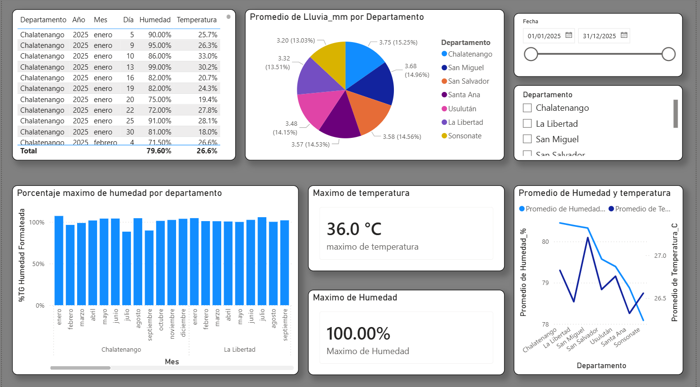
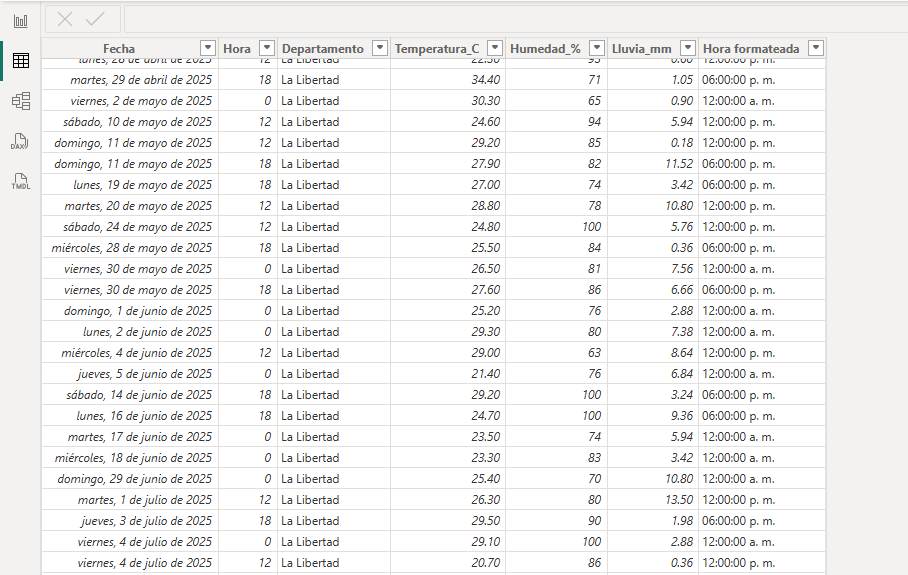

# 🌦️ Climate Data Analysis Dashboard — El Salvador


A Power BI dashboard that turns a year of agricultural weather readings from
**7 departments of El Salvador** into an interactive view of temperature,
humidity, rainfall and sowing conditions.

The goal was not just to plot numbers: the data is modelled for a decision —
*is today a good day to sow maize and beans?* — and the dashboard is built around
that question.

<p align="center">
  
</p>

---

## Table of contents

- [Key findings](#key-findings)
- [The dashboard](#the-dashboard)
- [Dataset](#dataset)
- [Data model & measures](#data-model--measures)
- [Project structure](#project-structure)
- [Reproducing the analysis](#reproducing-the-analysis)
- [Design decisions & known limitations](#design-decisions--known-limitations)
- [Roadmap](#roadmap)

---

## Key findings

| # | Finding | Evidence |
| - | ------- | -------- |
| 1 | **Rainfall is strongly seasonal.** 78 % of the year's rain falls between May and October. | 4,024.7 mm of a 5,136.7 mm total |
| 2 | **Temperature is remarkably stable.** Monthly means stay within 1.2 °C all year. | 25.9 °C (Jan) – 27.1 °C (Oct) |
| 3 | **Humidity is the most volatile variable.** It spans the full 50–100 % range, while temperature moves around a much tighter band. | Humidity σ = 10.0 vs temperature σ = 4.0 |
| 4 | **San Miguel is the warmest department**, Santa Ana the coolest. | 27.2 °C vs 26.3 °C mean |
| 5 | **Total rain per department is misleading.** San Salvador has 3× more readings than Sonsonate. | 457 vs 139 records |

`62.5 %` of readings are labelled *"Buena para Maíz/Frijol"*, `37.1 %`
*"No óptima – baja humedad o extremo temperatura"* and `0.4 %` (6 readings)
*"Alta lluvia – riesgo de erosión/inundación"*.

Extremes found in the dataset:

| Record | Value | Date | Department |
| ------ | ----- | ---- | ---------- |
| Hottest reading | 36.0 °C | 2025-02-06 00:00 | Usulután |
| Coldest reading | 18.0 °C | 2025-01-11 12:00 | Santa Ana |
| Wettest reading | 48.6 mm | 2025-09-29 18:00 | Usulután |

---

## The dashboard

| Visual | Question it answers |
| ------ | ------------------- |
| **Records table** (top-left) | What did each reading look like? Includes formatted humidity and temperature columns. |
| **Rain by department** (pie) | Which department gets the most rain on average? |
| **Max humidity by department/month** (columns) | Where and when does humidity peak? |
| **KPI cards** | What was the highest temperature (36.0 °C) and humidity (100 %) recorded? |
| **Humidity vs temperature** (dual-axis line) | Do warmer departments tend to be drier? |
| **Slicers** (date range + department) | Filter every visual to a period or a region |

<p align="center">
  
</p>

---

## Dataset

`data/dataset.csv` — 1,460 records, no missing values.

| Column | Type | Description |
| ------ | ---- | ----------- |
| `Fecha` | date | Reading date (`2025-01-01` → `2025-12-31`) |
| `Hora` | int | Hour of the reading: `0`, `6`, `12`, `18` |
| `Departamento` | text | One of 7 departments |
| `Temperatura_C` | float | Air temperature in °C (18.0 – 36.0) |
| `Humedad_%` | float | Relative humidity, 0–100 (50 – 100) |
| `Lluvia_mm` | float | Rainfall in mm (0.0 – 48.6) |
| `Recomendacion_Siembra` | category | Rule-based sowing advice (3 classes) |

**Structure:** 365 days × 4 readings per day = 1,460 records. Each reading is
assigned to a department, so the sampling is *uneven* (San Salvador 457,
La Libertad 233, Santa Ana 209, then ~140 each for the rest) — which is why the
dashboard compares **averages** rather than totals.

> ⚠️ The data is **simulated** (the source table is named
> `datos_meteorologicos_agricolas_sv_simulados`), so it demonstrates the
> analysis workflow, not real climate measurements. One tell: the hottest
> reading in the dataset is recorded at **00:00**.

<p align="center">
  
</p>

---

## Data model & measures

The dashboard uses a single flat table imported from the CSV, plus DAX measures
for the KPIs and the formatted axes.

```DAX
Humedad Formateada =
AVERAGE('datos_meteorologicos_agricolas_sv_simulados'[Humedad_%]) / 100

Maximo de Humedad =
MAX('datos_meteorologicos_agricolas_sv_simulados'[Humedad_%]) / 100

maximo de temperatura =
MAX('datos_meteorologicos_agricolas_sv_simulados'[Temperatura_C])

temp format =
AVERAGE('datos_meteorologicos_agricolas_sv_simulados'[Temperatura_C]) / 100
```

The `/ 100` division is a **formatting trick**: it maps 0–100 values onto 0–1 so
Power BI's percentage format renders them correctly. See
[limitations](#design-decisions--known-limitations) for why it is not ideal.

---

## Project structure

```text
climate-data-analysis-dashboard/
├── data/
│   └── dataset.csv                 # 1,460 records, 2025
├── powerbi/
│   └── climate-dashboard.pbix      # dashboard file (Power BI Desktop)
├── scripts/
│   ├── summarize.py                # reproduces the numbers above with pandas
│   └── requirements.txt
├── docs/images/                    # dashboard screenshots used in this README
│   ├── dashboard.png
│   ├── chart.png
│   └── dataset.png
└── README.md
```

---

## Reproducing the analysis

### Open the dashboard

1. Install [Power BI Desktop](https://powerbi.microsoft.com/desktop/) (free, Windows).
2. Open `powerbi/climate-dashboard.pbix`.
3. If Power BI asks for the data source, point it at `data/dataset.csv`.
   Moving the `.pbix` or the CSV changes the stored path, so a re-import may be
   needed after cloning.

### Verify the numbers without Power BI

```bash
cd climate-data-analysis-dashboard
pip install -r scripts/requirements.txt
python scripts/summarize.py --by-month
```

Output (abridged):

```text
=== Overview ===
Rows                : 1,460
Period              : 2025-01-01 -> 2025-12-31
Days                : 365
Readings per day    : 4
Departments         : 7 (Chalatenango, La Libertad, San Miguel, ...)

=== Metrics ===
Metric             Min     Mean      Max      Std
Temperature C     18.0     26.6     36.0      4.0
Humidity %        50.0     79.6    100.0     10.0
Rain mm            0.0      3.5     48.6      4.6
```

Every figure quoted in [Key findings](#key-findings) comes from this script.

---

## Design decisions & known limitations

**Decisions**

- Compared **averages per reading** instead of rain totals, because departments
  are sampled at very different rates.
- Kept a single flat table: with one year of data, a star schema would add
  complexity without analytical benefit.
- Added `scripts/summarize.py` so the README claims are reproducible outside
  Power BI.

**Known limitations**

- The **humidity-by-month column chart is flat**: since `MAX(Humedad_%)` is often
  100, dividing by 100 makes every bar 100 %. The measure should use
  `DIVIDE(AVG(...), 100)` or the model should store humidity as 0–1 with a
  percentage format.
- Dividing **temperature** by 100 to get a percentage format corrupts the
  magnitude; it should be a custom format string instead.
- With one year of data, "seasonal patterns" are a single cycle — no trend can
  be inferred.
- The sowing recommendation comes from rules in the source data, not from an
  independent agronomic model.

---

## Roadmap

- Split the model into `FactReadings` + `DimDate` + `DimDepartment` for
  year-over-year comparisons.
- Replace the fixed `/100` measures with proper format strings and a
  `Humedad (0–1)` column.
- Add a map visual (department polygons) and a drill-through page per department.
- Publish to Power BI Service and embed a public link in this README.
- Store the CSV in a versioned data folder with a checksum so refresh results
  are reproducible.

---

**Author:** Gonzalo Chavez · [@gonzalochavez0](https://github.com/gonzalochavez0)
